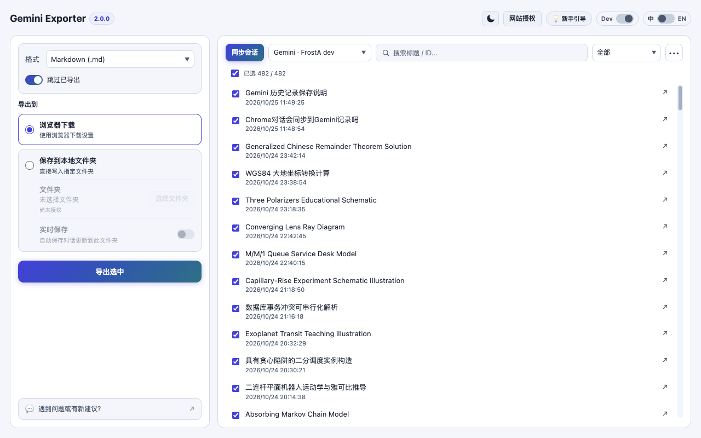

# 🌌 Gemini Exporter - Bulk Export All Chats & Auto Backup, Free!

<p align="left">
  <a href="./README.md">English</a> | <b>简体中文</b>
</p>

**你的 Gemini 对话，值得自己保存。** Gemini Exporter 是一款**免费、开源、完全在本地处理导出的**浏览器扩展，把 Google Gemini 对话保存成自己掌控的文件。无需 API Key、另行注册账号，也没有统计追踪。

<p align="left">
  <a href="https://chromewebstore.google.com/detail/gemini-exporter/ldpbiafkgjlaooeplkiooljccpalpkgf?utm_source=github&amp;utm_medium=readme_zh&amp;utm_campaign=github_repo">
    
  </a>
  
  
</p>


## ✨ 核心功能

- **单篇或批量备份**：一键保存当前对话，或扫描历史后按需选择批量导出。
- **四种格式**：**Markdown、HTML、PDF、JSON**，支持保存可获取的图片与文件附件。
- **两种保存方式**：浏览器下载或直接写入本地文件夹；浏览器下载多个文件时自动打包 ZIP。
- **持续保存更新**：增量扫描、跳过未变化的已导出对话，以及保存到本地文件夹的 **Markdown 实时保存**。
- **补全旧对话**：导入 Google Takeout 原始 ZIP，补充 Gemini 网页当前可访问的历史。

中英双语 · 明暗主题 · 导出状态与失败重试

## 📸 产品截图



[深色模式与本地文件夹设置](./store_assets/screenshot_2_1280x800.png) · [快捷导出弹窗](./store_assets/screenshot_popup_v2.png) · [网站授权](./store_assets/screenshot_site_access_1280x800.png)

*截图于 2026 年 10 月 25 日通过 9222 端口的真实 Chrome 拍摄，使用当前源码构建及实际同步的 Gemini 对话。*

## 🚀 三步开始

1. **安装插件**，打开 [Google Gemini](https://gemini.google.com) 中的对话。
2. **选择要保存的内容**：在插件弹窗点击**导出当前对话**；或打开**工作台**，点击**同步会话**并勾选需要备份的对话。
3. **导出文件**：在工作台选择格式与**浏览器下载 / 保存到本地文件夹**，点击**导出选中**。

**想自动保存？** 在工作台选择**保存到本地文件夹**，授权目录、选择 **Markdown**，然后开启**实时保存**。切换到其他格式或浏览器下载时会暂停。

**想补全更早历史？** 在工作台导入 [Google Takeout](https://takeout.google.com/settings/takeout) 中选择“我的活动 → Gemini 应用”并导入原始 ZIP（活动数据可能不含完整回答）。

**平台权限：** Gemini、ChatGPT、Claude、Grok 各自使用独立的可选网站权限组。在新手引导或“网站授权”中勾选需要的平台（默认全选），点击“授权”，Chrome 将一次申请所选平台会话和附件网站的访问权限。安装时不强制授予任何平台访问权，连接一个平台不会授权其他平台。ChatGPT、Claude 和 Grok 仍为源码版实验功能。Grok 复用 MIT 许可的 Loominary 解析器处理引用卡片和图片/文件附件，由现有渲染器导出文本、表格、代码、公式与已公开的思考步骤。当前打开会话中的图片按明确的消息归属采集；无法获取的附件、暂不支持的工具和无法确定的分支会明确标为部分导出。同步与导出时须保持已登录的 grok.com 标签页打开。

*注意：***同步会话**只更新会话目录，**导出选中**才会生成备份文件；部分过期附件可能无法恢复。

## 🔒 隐私优先

导出处理在本机完成，**不会上传到开发者运营的服务器**。插件通过现有的浏览器登录会话获取你请求的 Google Gemini 对话与资源；授予可选的网站访问权限后，也可获取 ChatGPT 对话与资源。

## 🛠️ 从源码安装

```bash
git clone https://github.com/OTLFrostA/gemini-exporter.git
cd gemini-exporter
npm install && npm run build
```

打开 Chrome 的 `chrome://extensions/`，开启**开发者模式**，点击**加载已解压的扩展程序**并选择仓库目录。

## 📚 更多文档

[使用指南与常见问题](./docs/USER_GUIDE_zh.md) · [隐私政策](./docs/PRIVACY_POLICY.md) · [v2 架构](./src/README.md) · [测试指南](./tests/README.md)

Gemini Exporter 是独立开源项目，**与 Google 无隶属或背书关系**。Google 和 Gemini 为 Google LLC 的商标。
