# Gemini Exporter 测试架构与规范指南 (Three-Tier Testing Architecture & Guide)

**v2 严格模块单测隔离：** 本文所称的历史 `npm run test:unit` 是混合回归入口，
并不表示其中每个文件只运行一个模块。真正的 v2 专属单测统一使用
`npm run test:v2:unit-ports` 和 `npm run test:v2:unit-isolation`，由
[模块单测隔离规范](../docs/v2-unit-isolation.md) 约束；任何执行真实多个
生产模块的测试保留为 Integration，不删除原有测试。


Provider fixture references can be audited without a browser via `node scripts/audit-provider-fixtures.cjs` (add `--json` for each literal key and its source locations). This is a static inventory, not proof that a fixture was executed. Browser and physical-export fidelity require their own tests.

本项目构建了严密、分层的**三层测试体系 (Three-Tier Testing Architecture)**，兼顾了 CI 自动化门禁的极致速度与生产环境真实链路的绝对可靠性。无论是人类开发者还是 AI 编程助手，在进行功能开发、Bug 修复或重构时，均须严格遵守本规范。

普通业务测试构造 canonical ConversationIndex 时，使用
`tests/helpers/conversationIndexFixture.ts` 的 `makeConversationIndex(overrides)`。
默认值为独立 Gemini Key、派生标题，时间仅在场景明确提供时存在；每次调用返回独立对象。
`key` 支持局部覆盖，标题与来源仍须成对合法。不要把原始 RPC、迁移、Schema 校验、类型负例或
测试无效数据的输入改成该工厂；这些测试需要保留显式原始输入。工厂不代替 Detail 摄入或模块隔离 mock。
工厂会加载真实 L2 恢复校验器，因此 UI / Runtime / Application / Storage 等隔离单测中的
外部 Index DTO 继续使用类型契约和所属模块的 mock，不为了复用工厂跨越模块边界。
标题缺失是测试条件时，显式传入 `title: undefined, titleSource: undefined`，避免默认标题影响用例。

---

## 一、三层测试体系架构总览

```mermaid
flowchart TD
    subgraph Tier1 [第一层：CI 自动化极速门禁 Tier 1 - Fast & Headless Gate]
        T1_A["python3 tests/run_tests.py<br>当前全量 TypeScript/Node 行为单元测试套件"]
        T1_B["npx playwright test<br>当前全量无头端到端测试"]
        T1_A --> T1_PASS["CI 门禁通过"]
        T1_B --> T1_PASS
    end

    subgraph Tier2 [第二层：真实 Chrome 特性驱动 E2E Tier 2 - Live Debug Staging]
        T2_CDP["./scripts/open_test_chrome.sh<br>独立调试 Chrome + CDP 9222 端口"]
        T2_DAG["DAGRunner 拓扑依赖调度器<br>19 大模块化 Feature 局部容灾解耦"]
        T2_Life["完整生命周期闭环<br>安装 -> 向导 -> 会话 -> 基准导出 -> 追加置顶 -> 瞬态删除 -> Takeout 合流 -> 卸载"]
        T2_Asserter["ExportSpecificationAsserter<br>物理解压 ZIP + 字节级严格断言 (零 Storage 篡改后门)"]
        T2_CDP --> T2_DAG --> T2_Life --> T2_Asserter
    end

    subgraph Tier3 [第三层：纯视觉 Agent 盲测 Tier 3 - Pure Visual Agent]
        T3_Provider["双途径架构驱动 (Two Pathways)<br>途径 1: 无 Context 子智能体 (Subagent)<br>途径 2: 自定义/第三方 AI 接口 (Custom AI)"]
        T3_Loop["看-想-动-验 物理事件闭环<br>纯截屏 PNG ➔ 模型视觉推算 ➔ CDP 硬件级键鼠派发"]
        T3_SelfHeal["自愈引擎 (Self-Healing Engine)<br>感知阻碍 ➔ 自动退避等待 ➔ 重新感知重试"]
        T3_Report["结构化 UX 体验报告<br>visual_audit_scorecard.md + visual_audit_report.html"]
        T3_Provider --> T3_Loop --> T3_SelfHeal --> T3_Report
    end
```



---

## 二、第一层：CI 自动化门禁测试 (Tier 1: Fast & Headless Gate)

### 1. 定位与设计原则
* **轻量极速**：完全在本地与 GitHub Actions 虚拟无头环境中运行，无须连接外网，无须真实 Google 账号。
* **100% 行为真断言**：彻底杜绝仅检查 `typeof === 'function'` 的假门面断言与源码文本正则匹配，通过构造具有完整 DOM 树与真实层级结构（折叠 recent 列表、滚动容器、会话链接树）的测试夹具，真实调用模块 API。
* **测试数量与耗时**：以当前运行结果为准，避免随 suite 扩展发生文档漂移。

### 2. 运行命令
```bash
# 执行完整 CI 门禁（scoped zero-any + 类型检查 + 当前全量单测 + 构建打包 + 当前全量无头集成用例）
npm test

# 或分别单独执行
npm run test:unit    # 运行 python3 tests/run_tests.py (当前全量单元测试套件)
npx playwright test  # 运行当前全量 Playwright 用例 (需先 node build.js)
```

### 3. 测试覆盖范围
* **核心解析与状态管理**：`gemini_parser`、`takeout_engine`、`conversation_order`、`conversations_store`、`chat_formatter`、`html_export`、`format_store` 等；
* **网络与恢复机制**：`gemini_client_retry`（HTTP 400 XSRF 重试、AbortSignal 干净终止、多页游标分页）、`storage_service`、`message_bridge`；
* **端到端完整格式导出**：`export_zip.spec.ts`（Markdown 格式导出与解压断言）、`html_export.spec.ts`（1:1 独立 HTML 格式导出、主题切换与打印样式断言）、`json_export.spec.ts`（Standard JSON 格式导出与完整 Domain 结构/角色断言）、`takeout_limit_prompt.spec.ts`、`page_sync.spec.ts`、`workbench_ui.spec.ts` 等。

---

## 三、第二层：真实调试 Chrome 全流程实跑测试 (Tier 2: Live Debug Staging)

### 1. 定位与设计原则
* **DAG 拓扑调度与故障局部隔离**：打破 778 行单体巨石，抽象 `FeatureTestCase` 与 `DAGRunner`，各特性根据 `prerequisites` 动态解析拓扑顺序。若发帖因外网波动失败，下游无依赖特性（Takeout 导入、Deep Scan 同步、搜索过滤、多语言切换）依然独立无损执行。
* **彻底铲除 Storage 篡改后门**：绝对禁止直接在控制台执行 `chrome.storage.local.set` 伪造导出时间戳。通过真实的业务生命周期：
  `会话 1 生成 ➔ 真实触发一轮导出落盘 ➔ 会话 1 追加提问 ➔ Options 页面通过真实 STREAM_COMPLETE 事件自然获得已更新徽章与置顶升权`。
* **生命周期两端完整闭环**：包含从扩展安装、新手向导、实时发帖、老会话置顶、瞬态删除清理、Takeout 合流，到扩展彻底卸载（Uninstall）与隔离清理的完整闭环。
* **固定长对话全文验收**：必选历史会话包含 `a714229ffb19b514`（《平稳时序的分割共形预测解析》，63 轮），标准联合导出至少覆盖 2 个现场会话和 5 个必选历史会话。`fixtures/gemini_long_conversation.json` 保存从重新加载的 Gemini 网页逐轮读取的独立正文证据。实际下载 ZIP 的 Markdown 必须按顺序匹配全部 63 个提问和回答全文，并核对代码缩进、换行及代码执行记录；只命中首尾片段或消息数量不能通过。该会话属于固定夹具，请勿继续追加或修改；若有意调整，必须重新从网页采集并审查基线，不能用导出文件反向生成预期结果。

### 2. 运行命令
```bash
# 启动独立调试 Chrome (端口 9222)
./scripts/open_test_chrome.sh          # macOS / Linux
.\scripts\open_test_chrome.ps1         # Windows PowerShell

# 标准模式：从场景池消费 2 个最新多模态场景运行全流程实跑测试
npm run test:tier2
# 或: python3 scripts/test_live_chat_and_export.py
```

---

## 四、第三层：纯视觉 AI 盲测与 UX 质检体系 (Tier 3: Pure Visual Agent)
 
### 1. 定位与双途径架构 (Two Pathways Only)
Tier 3 纯视觉测试专为评估黑盒环境下的真实视觉交互与自主探索而设计。**物理彻底删除了所有硬编码坐标点击与假退出捷径**，仅支持且必须通过以下两大标准途径执行：

* **途径一：无 Context 子智能体自主探索 (Subagent Mode, 首选推荐)**：
  - 由宿主 Agent（如 Antigravity）通过 `invoke_subagent` 拉起一个全新的、**无任何历史上下文污染的子智能体 (`Tier 3 Visual QA Explorer`)**；
  - 子智能体基于纯截屏视觉感知（0 DOM 树访问、0 JS 注入），自主推导目标、调度硬件级鼠标/键盘动作，并在推演完毕后如实沉淀特性清单、自愈轨迹与 UX 风险。
  - **父 Agent 编排三轮、子 Agent 保持自由**：首轮只做纯自主探索、不提前展示清单；首轮返回后，父 Agent 将 [`tier3-exploration-checklist.md`](../docs/tier3-exploration-checklist.md) **完整正文**发给**同一子 Agent 会话**继续探索；第二轮返回后，再发送**同一份完整正文**一次；第三轮返回后才提交最终报告。不中途重开 Playground，不添加时间/操作预算，也不要求 100% 勾选。详见 [`AGENTS.md`](../AGENTS.md) 的父 Agent 执行协议；如果宿主工具不支持续发同一个子 Agent，应如实告知，不能冒充续跑。
* **途径二：自定义 / 第三方 AI 接口驱动 (Custom AI API Mode)**：
  - 面向未来或外部第三方多模态 AI 接入，通过通用 `CustomAIVisionProvider` 连接兼容 OpenAI 或自建多模态视觉端点（`CUSTOM_AI_ENDPOINT`）；
  - 自动驱动 `AutonomousVisualAgent` 的 ReAct 推演循环完成指定自然语言目标，并可生成在线视觉体检审查报告。

### 2. 受测 AI 受控交互接口 (Strict Interface Isolation - 7 大 CLI 原语)
受测智能体与宿主环境绝对物理隔离，**只能且仅能**通过调用 `scripts/visual_agent/cli.py` 提供的 7 个原子命令来感知和操作界面（0 DOM 泄露，严禁控制台后门）：
1. 📸 **截屏感知**：`python3 scripts/visual_agent/cli.py screenshot --target <options|popup|gemini> [--name <name>]`
2. 🖱️ **物理鼠标点击**：`python3 scripts/visual_agent/cli.py click --target <target> --x <0.0-1.0> --y <0.0-1.0>`
3. ⌨️ **物理键盘键入**：`python3 scripts/visual_agent/cli.py type --target <target> --text "<text>" [--x <x> --y <y>]`
4. 📜 **物理滚轮滚动**：`python3 scripts/visual_agent/cli.py scroll --target <target> --delta <pixels>`
5. ⏳ **确定性挂起等待**：`python3 scripts/visual_agent/cli.py wait-on --condition <stream_settled|zip_downloaded|ui_idle>`
6. 🔄 **环境重置**：`python3 scripts/visual_agent/cli.py reset --target <target> [--reinstall]`
7. 📦 **导出规范评测**：`python3 scripts/visual_agent/cli.py evaluate-export --zip <path>`

### 3. 运行命令
```bash
# 途径一：就绪交互靶场 (供人类或无 Context 子智能体 Subagent 探索)
python3 scripts/test_visual_agent.py --playground [--target options|popup|gemini]

# 途径二：通过自定义 AI 接口执行推演
python3 scripts/test_visual_agent.py --api --endpoint <url> [--model <name>] [--goal "<测试目标>"]
# 或: python3 scripts/test_visual_agent.py --api --endpoint <url> [--ai-review]
```

---

## 五、正式 1.7.0 原地升级回归

在大版本重构发布前运行此专用浏览器回归。它使用真实发布的旧运行时、真实 Chrome 持久化 profile 和生产写入路径；两个账号的协议响应是确定性网络夹具，不需要 Google 登录。它不等同于带真实 Google 账号的 Tier 2，也不替代 Tier 2。不得用 storage seed 或全新安装替代它。

```bash
gh release download v1.7.0 --pattern gemini-exporter-v1.7.0.zip --dir temp/upgrade-assets
npm run package
npm run test:upgrade -- --old-zip temp/upgrade-assets/gemini-exporter-v1.7.0.zip --candidate-zip gemini-exporter-v1.8.0.zip --output-dir temp/upgrade-audit-new
```

输出目录必须不存在；已有目录会被拒绝，原始基线不会被覆盖。旧 ZIP SHA256 固定为正式 release 的 `b79ed42a1dc080094fd78ca991f69d1a04f5b7e19fe3c20f45a5aec57b0f83cf`。候选版本必须高于 1.7.0，报告记录两份包的版本/SHA、Chrome 版本、扩展 ID、测试代码 commit 和各阶段状态。

旧版本通过真实同步按钮、Takeout 文件输入和下载流程建立两个账号的多轮历史、图片和导出记录。关闭浏览器后，原始 profile 被复制到 `baseline-profile/` 并计算整树 SHA；`baseline.json` 保存全部 local storage 和 IndexedDB 的只读快照（字节值转换为 SHA），设为只读。测试保留同一个安装路径、扩展 ID 和工作 profile，通过 Chrome 原生 `Extensions.loadUnpacked` 更新运行时，不执行卸载、删除 IndexedDB 或清空 storage。仅替换文件不足以保证 MV3 后台已更新。

检查内容包括旧 ID/标题/时间戳及完整导出记录保全、重启后账号隔离、禁止重新拉取时的旧正文/图片可用性、新活动的增量 Markdown 导出、完整 HTML/PDF 逐轮正文/代码/数学结构，以及受控取详情失败的诊断与不误标成功。各阶段独立报告，任何失败都会保留总体失败和非零退出码；后续独立阶段通过不能把整体改为通过。物理 ZIP、错误日志和截图均保留供检查。

**实际旧版边界：** 正式 1.7.0 的此次生产流程将列表和导出标记写入 local storage，但 Takeout 缓存使用页面内存；原始 IDB 快照没有持久化正文/图片记录。因而禁止云端补拉的升级内容检查目前失败。此失败不允许通过重新导入原 ZIP、手动 seed 或跳过该阶段消除；需要原始 Takeout/既有导出或可访问的云端来源恢复从未落盘的内容。不能把这些恢复动作描述成 profile 自身保全通过。当前正常联网增量、HTML/PDF 全文、两个账号隔离与失败不误标的独立阶段已通过真实浏览器运行。

重型升级回归不加入每次 CI；CI 包含无浏览器的反例，确保未验证的旧包、缺少身份参数和覆盖已有基线都不能返回成功。

## 六、测试生命周期标记 (Test Lifetime: `@retire-when`)

为某个版本、某个修复**临时**加的回归锁（regression lock），必须打可 grep 的生命周期 tag，
否则未来没人知道它什么时候可以退役。约定：

```ts
// @retire-when: <condition>   — 例子：
// @retire-when: schema v5 ships
// @retire-when: Chrome 130+ only
// @retire-when: unknown — needs owner   （拿不准条件时用这一行，不要空着）
```

- 新的临时锁：打在单个 `test(...)` 上方，条件写具体事件（版本发布 / 修复落地 / 平台条件）。
- 已存在的锁文件：若整文件都是锁，在文件头打一个 file-level tag。
- 永久 invariant 测试（打包不变量、架构文档存在性等）**不打**此 tag。
- 删除锁是 PR11 的事；本标记只做分类。

